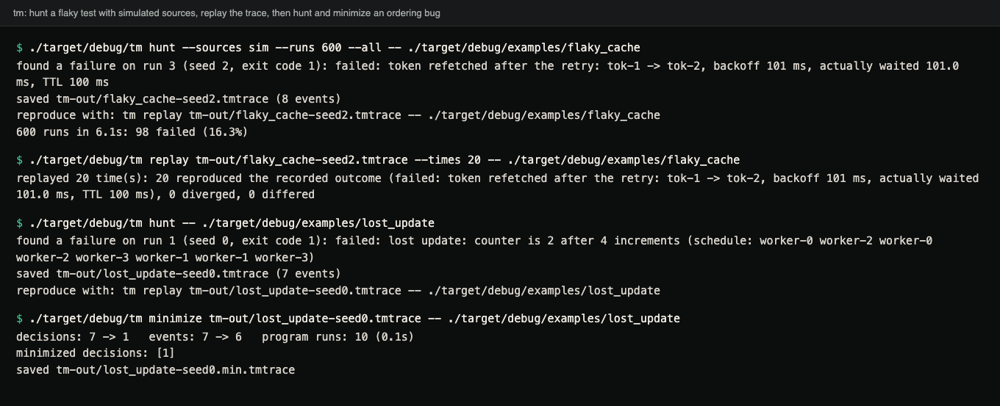
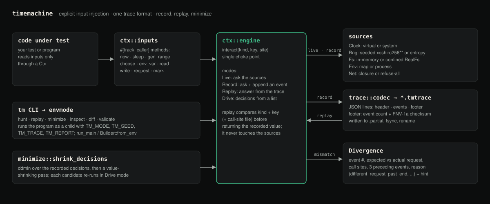
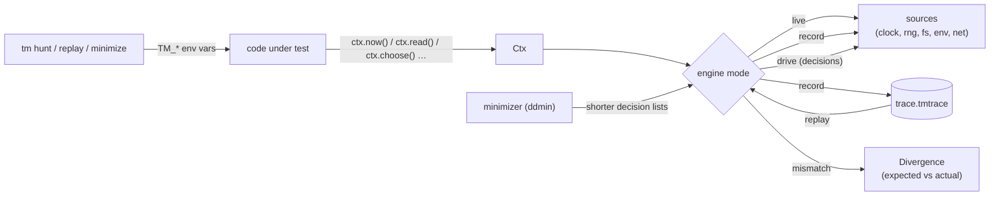

# Deterministic-TimeMachine


**Make flaky tests reproducible.** Route time, randomness, files, environment variables, network responses and scheduling choices through one small handle (`Ctx`). Record a run to a trace, replay it exactly, get a precise diagnostic the moment the code takes a different path, and shrink failing traces with delta debugging.

[Case study ↗](https://hellpuff.dev/work/deterministic-timemachine)

## Demo



Terminal capture of a real session with the bundled examples, after `cargo build --examples --bins`:
a seeded hunt over 600 runs, 20 replays of the saved trace, then a hunt and minimization of the
`lost_update` ordering bug. Run times vary by machine; the seeds, counts and traces do not.

<details>
<summary>Same output as text</summary>

```console
$ ./target/debug/tm hunt --sources sim --runs 600 --all -- ./target/debug/examples/flaky_cache
found a failure on run 3 (seed 2, exit code 1): failed: token refetched after the retry: tok-1 -> tok-2, backoff 101 ms, actually waited 101.0 ms, TTL 100 ms
saved tm-out/flaky_cache-seed2.tmtrace (8 events)
reproduce with: tm replay tm-out/flaky_cache-seed2.tmtrace -- ./target/debug/examples/flaky_cache
600 runs in 6.1s: 98 failed (16.3%)

$ ./target/debug/tm replay tm-out/flaky_cache-seed2.tmtrace --times 20 -- ./target/debug/examples/flaky_cache
replayed 20 time(s): 20 reproduced the recorded outcome (failed: token refetched after the retry: tok-1 -> tok-2, backoff 101 ms, actually waited 101.0 ms, TTL 100 ms), 0 diverged, 0 differed

$ ./target/debug/tm hunt -- ./target/debug/examples/lost_update
found a failure on run 1 (seed 0, exit code 1): failed: lost update: counter is 2 after 4 increments (schedule: worker-0 worker-2 worker-0 worker-2 worker-3 worker-1 worker-1 worker-3)
saved tm-out/lost_update-seed0.tmtrace (7 events)
reproduce with: tm replay tm-out/lost_update-seed0.tmtrace -- ./target/debug/examples/lost_update

$ ./target/debug/tm minimize tm-out/lost_update-seed0.tmtrace -- ./target/debug/examples/lost_update
decisions: 7 -> 1   events: 7 -> 6   program runs: 10 (0.1s)
minimized decisions: [1]
saved tm-out/lost_update-seed0.min.tmtrace
```

</details>

> **Status: experimental, v0.1.0, not production-ready.** The library and the `tm` CLI work and are tested (see [docs/PRODUCTION_READINESS.md](docs/PRODUCTION_READINESS.md)), but the API may change before 1.0.

A test that fails on some runs, because of real timing and real randomness:

```console
$ ./target/debug/examples/flaky_cache --live-runs 30
…
run  25: FAILED  token refetched after the retry: tok-1 -> tok-2, backoff 99 ms, actually waited 100.4 ms, TTL 100 ms
run  28: FAILED  token refetched after the retry: tok-1 -> tok-2, backoff 101 ms, actually waited 106.0 ms, TTL 100 ms
30 live runs: 18 failed, 12 passed
```

(Measured on an Apple M5 with load average ~8 from other builds; real sleeps overshoot under load, which is exactly what makes this test flaky. On an idle machine it fails less often.)

Capture one failing run, then replay it as often as you like:

```console
$ ./target/debug/tm hunt -- ./target/debug/examples/flaky_cache
found a failure on run 1 (real+custom sources, exit code 1): failed: token refetched after the retry: tok-1 -> tok-2, backoff 101 ms, actually waited 101.7 ms, TTL 100 ms
saved tm-out/flaky_cache-run1.tmtrace (8 events)
reproduce with: tm replay tm-out/flaky_cache-run1.tmtrace -- ./target/debug/examples/flaky_cache

$ ./target/debug/tm replay tm-out/flaky_cache-run1.tmtrace --times 20 -- ./target/debug/examples/flaky_cache
replayed 20 time(s): 20 reproduced the recorded outcome (failed: token refetched after the retry: tok-1 -> tok-2, backoff 101 ms, actually waited 101.7 ms, TTL 100 ms), 0 diverged, 0 differed
```

With real sources the failing run number and timings change on every hunt. The replay reproduces even the measured `101.7 ms`, and all 20 replays together took 0.14 s: replay answers `sleep` and `now` from the trace instead of waiting.

## Why

A flaky test is a test whose inputs you don't control: the clock, a random seed, the order two tasks ran in, a file another test left behind, a slow response. Re-running it until it fails tells you nothing about *why*. Common workarounds each cover one source: a mock clock here, a fixed seed there, `--test-threads=1` everywhere. Record/replay debuggers such as `rr` capture *everything* at the system-call level, which covers far more, but is Linux-only, heavyweight and not something you put in a test suite.

Deterministic-TimeMachine sits in between: **explicit dependency injection** for the inputs that usually cause flakiness, one trace format for all of them, and tooling around it (hunt, replay, divergence diagnostics, minimization). It is for Rust developers who own the code under test and are willing to read time, randomness, files, environment and network through a `Ctx`. It does not intercept syscalls and cannot make arbitrary code deterministic; see [docs/UNSUPPORTED.md](docs/UNSUPPORTED.md).

## Quick start

Requires Rust 1.85 or newer.

```sh
git clone https://github.com/hellpuffyt/Deterministic-TimeMachine && cd Deterministic-TimeMachine
cargo test                                            # all tests; 1 maintenance helper is ignored on purpose
cargo build --examples --bins
./target/debug/examples/flaky_cache --live-runs 30    # watch it flake
./target/debug/tm hunt -- ./target/debug/examples/flaky_cache
```

Then `tm replay` the saved trace as shown above.

## Using it in your code

Add the library (it is not on crates.io yet; use the git URL):

```toml
[dev-dependencies]
deterministic-timemachine = { git = "https://github.com/hellpuffyt/Deterministic-TimeMachine", default-features = false }
```

Read every nondeterministic input through a `Ctx`:

```rust
use std::time::Duration;
use timemachine::{Ctx, harness};

fn backoff_fits_deadline(ctx: &Ctx) -> Result<(), String> {
    let start = ctx.now();
    ctx.sleep(Duration::from_millis(90 + ctx.gen_range(0..20)));
    let waited = ctx.now() - start;
    if waited > Duration::from_millis(100) {
        return Err(format!("deadline missed: waited {waited:?}"));
    }
    Ok(())
}

#[test]
fn finds_and_replays_the_failure() {
    // Simulated sources by default: virtual clock (sleeps are instant), seeded RNG.
    let found = harness::explore("backoff", Default::default(), |b| b, backoff_fits_deadline)
        .first_failure
        .expect("about half of all seeds fail");
    found.trace.save(std::env::temp_dir().join("backoff.tmtrace")).unwrap();
    // Every replay of the trace fails the same way.
    assert!(harness::replay(&found.trace, |b| b, backoff_fits_deadline).reproduced);
}
```

`Ctx` offers `now`, `now_nanos`, `sleep`, `next_u64`, `gen_range`, `gen_bool`, `choose`, `shuffle`, `env_var`, `read`, `read_to_string`, `write`, `exists`, `remove`, `list`, `request` and `mark`. Each call is one event in the trace.

To let the `tm` CLI control a program (or a test binary), build the context from the environment:

```rust
fn main() -> std::process::ExitCode {
    timemachine::run_main("my_test", |b| b.real_sources(), my_test)
}
```

or, inside an ordinary `#[test]`, `Builder::new("my_test").from_env()?` (the trace is written when the context is dropped, including on panic). With no `TM_*` variables set the program behaves exactly as before.

## Features

**Implemented**
- `Ctx` with record, replay, live and drive modes; clones share one recording.
- Sources: virtual and system clocks, seeded xoshiro256\*\* and entropy RNGs, in-memory and confined real filesystems, map and process environments, closure-backed or disabled network. Each is a small trait you can implement.
- Trace format v1: one JSON object per line, header + events + footer with event count and FNV-1a checksum over the event lines; truncation, reordering, edited event lines, wrong format, wrong version and oversized files are each rejected with a specific, actionable error. Loading streams the file and is capped at 1 GiB by default (`TM_MAX_TRACE_BYTES` / `Trace::load_with_limit` to raise it).
- Divergence diagnostics: event index, expected vs actual request, call sites, three preceding events, reason (`different_request`, `different_site`, `past_end`, `ended_early`, `bad_value`), and a hint. Call-site checking: exact, file-only (default), or off.
- `harness::explore` / `harness::replay` / `minimize::minimize` in-process; ddmin plus a value-shrinking pass over decisions.
- `sched`: a cooperative, deterministic scheduler whose interleavings are recorded choices.
- `tm` CLI: `hunt`, `replay`, `minimize`, `inspect`, `diff`, `validate`; per-run timeouts; JSON run reports.

**Experimental**
- `real_sources()` recordings of `RealFs`: replay is hermetic, but recording follows symlinks inside the root (see Limitations).
- Failure matching for minimization by message *signature* (text before the first `:`).

**Planned** (no code yet; see [docs/LIMITATIONS.md](docs/LIMITATIONS.md#roadmap))
- An async adapter (virtual-time timers for tokio-style executors).
- A `#[timemachine::test]` attribute macro.
- Publishing to crates.io.

## How it works



<sub>Diagram (not a screenshot) of the real modules (`ctx::inputs`, `ctx::engine`, `sources`, `trace::codec`, `divergence`, `envmode`, `minimize`, `bin/tm`).</sub>



Details, including the trace format and why the RNG is implemented in-crate, are in [docs/ARCHITECTURE.md](docs/ARCHITECTURE.md). [docs/DETERMINISM.md](docs/DETERMINISM.md) states the exact replay guarantee: what is controlled, what is not, which tests check each claim, and measured memory use for 1M- and 10M-event traces.

## More examples

**Find failures deterministically, and check a fix.** With simulated sources a failure is a pure function of the seed:

```console
$ ./target/debug/tm hunt --sources sim --runs 600 --all -- ./target/debug/examples/flaky_cache
found a failure on run 3 (seed 2, exit code 1): failed: token refetched after the retry: tok-1 -> tok-2, backoff 101 ms, actually waited 101.0 ms, TTL 100 ms
saved tm-out/flaky_cache-seed2.tmtrace (8 events)
reproduce with: tm replay tm-out/flaky_cache-seed2.tmtrace -- ./target/debug/examples/flaky_cache
600 runs in 3.9s: 98 failed (16.3%)

$ FLAKY_CACHE_VARIANT=fixed ./target/debug/tm hunt --sources sim --runs 600 -- ./target/debug/examples/flaky_cache
no failure in 600 runs (3.9s)
```

16.3 % matches the bug: the backoff is 90 ms plus 0–11 ms of jitter, the TTL is 100 ms, so 2 of 12 jitter values fail (16.7 %).

**Replay detects a changed program.** `FLAKY_CACHE_VARIANT=extra-draw` adds one random draw:

```console
$ FLAKY_CACHE_VARIANT=extra-draw ./target/debug/tm replay tm-out/flaky_cache-run1.tmtrace -- ./target/debug/examples/flaky_cache
replay diverged at event #3 of 8: the program requested a different input than was recorded
  expected: #3 clock.now = 1792645468499946000  at examples/flaky_cache.rs:68:22
  actual:   #3 rng.u64  at examples/flaky_cache.rs:64:21
  preceding recorded events:
    #0 clock.now = 1792645468499923000  at examples/flaky_cache.rs:35:23
    #1 net.request "POST https://auth.example.test/token len=0 fnv=cbf29ce484222325" = HTTP 200  at examples/flaky_cache.rs:42:14
    #2 rng.u64 = 16016662143760679591  at examples/flaky_cache.rs:62:22
  hint: the code or its inputs changed since the trace was recorded; re-record it, or fix the change that made the run take a different path
run 1: DIVERGED
replayed 1 time(s): 0 reproduced the recorded outcome (failed: token refetched after the retry: tok-1 -> tok-2, backoff 101 ms, actually waited 101.7 ms, TTL 100 ms), 1 diverged, 0 differed
```

(`tm replay` exits 3 on divergence, 1 when the outcome differs, 0 when every replay reproduced.)

**Minimize an ordering bug.** `examples/lost_update.rs` runs four read-then-write workers on the deterministic scheduler:

```console
$ ./target/debug/tm hunt -- ./target/debug/examples/lost_update
found a failure on run 1 (seed 0, exit code 1): failed: lost update: counter is 2 after 4 increments (schedule: worker-0 worker-2 worker-0 worker-2 worker-3 worker-1 worker-1 worker-3)
saved tm-out/lost_update-seed0.tmtrace (7 events)

$ ./target/debug/tm minimize tm-out/lost_update-seed0.tmtrace -- ./target/debug/examples/lost_update
decisions: 7 -> 1   events: 7 -> 6   program runs: 10 (0.1s)
minimized decisions: [1]
saved tm-out/lost_update-seed0.min.tmtrace
```

The minimal failure is a single out-of-order choice: worker-1 reads before worker-0 writes.

## Configuration reference

`Builder` (library): `seed(u64)`, `real_sources()`, `clock(..)`, `rng(..)`, `fs(..)`, `env(..)`, `net(..)`, `site_check(SiteCheck::{Exact, File, Off})`, then `live()`, `record()`, `replay(trace)`, `drive(decisions)` or `from_env()`.

Environment variables (set by `tm`, readable by any program using `from_env`/`run_main`; see [.env.example](.env.example)):

| variable | meaning |
|---|---|
| `TM_MODE` | `live` (default), `record`, `replay`, `drive` |
| `TM_TEST` | only the context with this test name obeys the other variables |
| `TM_SEED` | seed for simulated sources (record) |
| `TM_SOURCES` | `sim` or `real` (record); default: what the program configured |
| `TM_TRACE` | trace to write (record, drive) or read (replay) |
| `TM_DECISIONS` | JSON array of decisions (drive) |
| `TM_REPORT` | where to write a JSON run report |
| `TM_MAX_TRACE_BYTES` | largest trace file to load (default 1 GiB); not set by `tm`, honoured by `tm` and by the program |

`run_main` exit codes: 0 passed, 1 failed/panicked, 2 invalid `TM_*` configuration, 3 replay diverged. `tm` exit codes: 0 success, 1 negative result (no failure found / not reproduced / traces differ / invalid trace), 2 usage or environment error, 3 divergence.

## Testing

```sh
cargo test --all-features            # unit, property, acceptance, malformed-input and CLI end-to-end tests
cargo clippy --all-targets --all-features -- -D warnings
cargo +1.85 test --all-features      # MSRV check
```

The CLI tests run the real `tm` binary against the example programs. One test is `#[ignore]`d on purpose: it regenerates `tests/fixtures/token_cache.tmtrace` and is run explicitly when that fixture must change.

There are no benchmarks; the timings above are wall-clock observations from single runs on a loaded machine, not performance claims. Memory for large traces was measured once with `examples/trace_scale.rs` (numbers and method in [docs/DETERMINISM.md](docs/DETERMINISM.md#memory-and-size)).

## Security model

- `tm hunt|replay|minimize` execute the command you give them, with your user's rights, as a shell would.
- A trace is **input to your program**: replaying it feeds the recorded values to the code under test. Treat trace files like test fixtures from a contributor and review them before replaying.
- Trace parsing does not execute anything, rejects malformed input with errors (a property test feeds it 256 randomly corrupted traces per run and checks it never panics or misreads one), and reads at most 1 GiB by default (configurable), so a huge or endless input cannot exhaust memory. Parsed traces are held in memory: about 150 bytes per event.
- `RealFs` refuses absolute paths and `..` components, but follows symlinks that already exist inside its root.
- The default network source refuses every request, so a test cannot reach a real host by accident.
- Recorded traces contain whatever your program read: file contents, environment variables, response bodies. **Do not commit traces recorded with real sources without checking them for secrets.**

Report vulnerabilities privately: see [SECURITY.md](SECURITY.md).

## Troubleshooting

- **`left no usable trace`** from `tm hunt`: the program does not build its context with `Builder::from_env()`/`run_main`, or `--test` does not match its test name.
- **`did not reproduce`**: the program reads something nondeterministic outside the `Ctx` (a `std::time::Instant`, `HashMap` iteration order, a thread race). See [docs/UNSUPPORTED.md](docs/UNSUPPORTED.md).
- **Divergence right after an edit**: expected when the edit changes which inputs are read. Line moves within a file are tolerated by default (`SiteCheck::File`).
- **`checksum mismatch`**: the trace was edited. `tm inspect --no-verify` still shows it; the library has `Trace::parse_with(text, false)`.
- **`driving the original … decisions did not reproduce`** from `tm minimize`: minimization needs deterministic non-random inputs; record with `--sources sim`.

## Limitations and roadmap

See [docs/LIMITATIONS.md](docs/LIMITATIONS.md) and [docs/UNSUPPORTED.md](docs/UNSUPPORTED.md). Highlights: no syscall interception; only inputs read through `Ctx` are controlled; the scheduler controls your steps, not OS threads; CI (Linux, macOS, Windows) passes, but Windows has had no testing beyond the CI suite.

## Contributing

Contributions are welcome. Start with [CONTRIBUTING.md](CONTRIBUTING.md) and [docs/good-first-issues.md](docs/good-first-issues.md).

## License

Dual-licensed under [MIT](LICENSE-MIT) or [Apache-2.0](LICENSE-APACHE), at your option.
