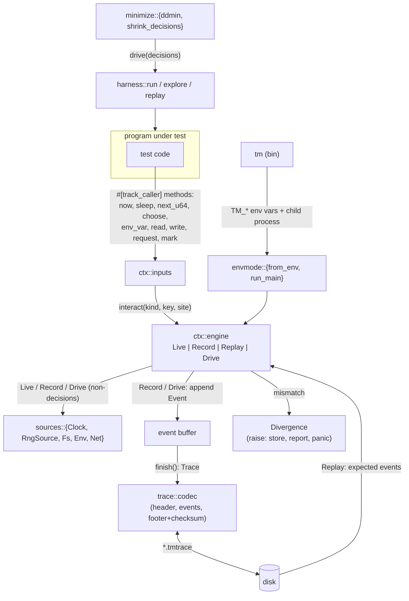

# Architecture

## Goals and non-goals

**Goal:** a failing run of a test can be captured once and then reproduced on demand, with a clear explanation when reproduction is no longer possible because the code changed.

**Non-goal:** making arbitrary programs deterministic. Only inputs read through a `Ctx` are controlled. There is no syscall interception, no thread-scheduler control, no `LD_PRELOAD`. This keeps the tool portable (it is plain Rust), safe (nothing is patched at runtime) and honest about what it covers.

## Data flow



## Modules

| module | responsibility |
|---|---|
| `ctx::builder` | Chooses sources (simulated by default, `real_sources()`, or explicit), seed, site-check policy and mode. |
| `ctx::engine` | The state machine. `interact` is the single choke point: every input passes through it, so record, replay and drive are implemented once. |
| `ctx::inputs` | Public input methods. Each converts its request into a `(Kind, key)` pair and its answer to/from a `trace::Value`. |
| `ctx` (mod) | `Ctx`, `finish`, introspection, and the `Drop` fallback that writes environment-driven traces on panic. |
| `trace` | Event model and the file format; `codec` serializes and validates; `error` lists every way a file can be bad. |
| `divergence` | The structured diagnostic and its human-readable rendering. |
| `harness` | Run a test closure under a context with panic capture; `explore` seeds; `replay` a trace. |
| `minimize` | `ddmin` (generic), `shrink_decisions` (ddmin + value pass), and `minimize` (in-process driver). The CLI reuses `shrink_decisions`. |
| `sched` | Cooperative deterministic scheduler; interleavings become `choose` events. |
| `envmode` | `TM_*` variables, `Builder::from_env`, `run_main`, JSON run reports. |
| `sources` | The five source traits and their simulated/real implementations. |
| `bin/tm` | CLI: `hunt`, `replay`, `minimize`, `inspect`, `diff`, `validate`; child process runner with timeouts. |

## Key decisions

**One choke point.** Every input goes through `Ctx::interact(kind, key, site, …)`. Adding a new kind of input means adding a `Kind` variant and a method in `ctx::inputs`; recording, replay checking, drive mode and divergence reporting come for free.

**Requests are checked, not just answers.** The *key* of an event is the request (the path read, the variable name, the request line plus a body hash, the sleep duration). On replay the engine compares kind and key before handing back the recorded value. That is what turns "replay silently returns garbage" into "replay diverged at event #3: expected env.var "RETRIES", got env.var "RETRY_COUNT"".

**Call sites via `#[track_caller]`.** Each event stores `file:line:column` of the user's call. By default only the *file* must match on replay (`SiteCheck::File`), so editing unrelated lines does not invalidate a trace; `Exact` and `Off` are available.

**Divergence panics.** When replay can no longer supply the input the program asked for, there is no meaningful value to return. The engine stores the divergence, writes the JSON report (environment-driven runs), and panics with the diagnostic. Any later input request panics again, so a program that catches the first panic cannot continue on made-up data. `harness::run` turns this into `OutcomeKind::Diverged`.

**Replay never consults sources.** A replayed `sleep` does not sleep, a replayed `read` does not touch the disk, a replayed `request` does not use the network. `tests/record_replay.rs::replay_never_consults_sources` enforces this with sources that panic when called.

**In-crate RNG.** `SeededRng` is xoshiro256\*\* seeded with SplitMix64, implemented in ~30 lines and pinned by golden values (cross-checked against an independent implementation and the published SplitMix64 reference output). A dependency upgrade can therefore never change the stream for a seed, which would silently invalidate seed-only reproductions.

**Decisions vs observations.** Random draws and `choose` results are *decisions*: values the program draws rather than observes. Drive mode feeds decisions from a list (zeros when exhausted) and asks the sources for everything else. Shrinking the list yields a different but valid execution, which is what makes delta debugging applicable. Observations (time, files, network) are kept deterministic by using simulated sources during minimization.

**Failure identity for minimization.** By default two failures are "the same" if their messages agree up to the first `:` (`FailureMatch::Signature`), so messages can carry details (`lost update: counter is 3 …`) without blocking shrinking. `Exact` and `Any` are available.

## Trace format (version 1)

One JSON object per line:

1. `{"header":{"format":"timemachine-trace","version":1,"test":…,"seed":…,"sources":…,"created_by":…}}`
2. zero or more `{"event":{"seq":N,"kind":…,"key":…,"value":…,"site":…}}` with `seq` counting from 0,
3. `{"end":{"events":N,"outcome":…,"message":…,"checksum":"<fnv1a64 hex>"}}`.

The checksum is FNV-1a 64 over the exact bytes of the event lines (each followed by `\n`). It detects accidental corruption and hand edits; it is **not** a security mechanism. `Value` is externally tagged (`{"u64":5}`, `"unit"`, `{"bytes":{"utf8":"…"}}` or `{"bytes":{"hex":"…"}}`, `{"err":{"kind":"NotFound","message":"…"}}`, …). Any incompatible change bumps `trace::VERSION`; readers reject other versions with a message telling the user to re-record.

Traces are streamed to `<path>.tmtrace.partial`, flushed to disk (`fsync`) and renamed, so a reader never sees a half-written file. Reading streams the file line by line through a reader bounded by a size limit (`trace::DEFAULT_MAX_TRACE_BYTES`, 1 GiB), so neither a huge file nor an endless input is read whole. The checksum covers event lines only; see [DETERMINISM.md](DETERMINISM.md#trace-integrity).

## The CLI protocol

`tm` launches the program as a child process with `TM_*` variables (see the README) and reads back two files from a private scratch directory: the trace (`TM_TRACE`) and a JSON run report (`TM_REPORT`) that says whether a replay reproduced the recorded outcome or diverged. Programs that use `run_main` produce both; programs that only use `Builder::from_env` produce the trace (written on drop), and `tm replay` falls back to comparing exit status.

## Regenerating fixtures

`tests/fixtures/token_cache.tmtrace` is recorded by `explore` over the token-cache test in `tests/common/mod.rs`. If an intentional change alters that test's input sequence, regenerate it and explain why in the pull request:

```sh
cargo test --test explore_minimize -- --ignored regenerate
```
